# Active Directory Lab: Automated User Onboarding and Offboarding

A small home lab where I built a Windows Active Directory domain from scratch and wrote two PowerShell scripts to automate the start and end of an employee's life in the company: creating accounts in bulk, and safely shutting them down when someone leaves.

I built this to get hands-on with the identity and access side of IT (the stuff help desk, sysadmin and security teams do every day).

## What I built

- A Windows Server 2022 domain controller (`DC01`) running Active Directory Domain Services and DNS, for the domain `lab.local`
- Organizational Units (OUs) for IT, HR and Sales, plus a "Disabled Users" OU for people who have left
- A security group for each department (`IT-Staff`, `HR-Staff`, `Sales-Staff`)
- `New-BulkUsers.ps1`: reads a CSV file and creates every user in the right OU and group
- `Disable-LabUser.ps1`: deprovisions a user (disable the account, remove from groups, move to Disabled Users, write to an audit log)
- Two Group Policy Objects: a domain-wide password policy (minimum 12 characters) and a Screen Lock policy linked to the HR OU

## Lab setup

| Item | Detail |
|---|---|
| Hypervisor | VMware Workstation Pro 26H1 |
| Server OS | Windows Server 2022 Standard (Evaluation, Desktop Experience) |
| Domain | `lab.local` (NetBIOS name `LAB`) |
| Network | NAT, 192.168.50.0/24 |
| DC01 | Static IP 192.168.50.10, DNS pointing to itself |

## How I did it

1. Created the VM in VMware and installed Windows Server 2022 (I hit an installer error with Easy Install, so I created the VM with "install the OS later" and booted the ISO manually).
2. Gave the server a static IP and set its DNS to itself, since a domain controller needs to be its own DNS server.
3. Installed the AD DS and DNS roles in Server Manager and promoted the server to a domain controller for a new forest, `lab.local`.
4. Created the OUs and security groups in Active Directory Users and Computers.
5. Wrote the bulk onboarding script and ran it against `users.csv`.
6. Wrote the offboarding script, tested it, found a bug (see below) and fixed it.

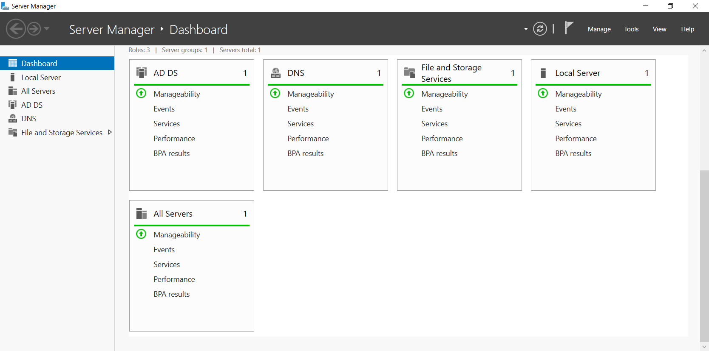
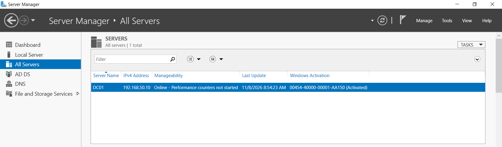

## Script 1: Bulk user creation

`scripts/New-BulkUsers.ps1` reads `scripts/users.csv` (first name, last name, username, department). For each row it:

- skips the user if the username already exists (so it is safe to run twice)
- creates the account in the OU that matches the department
- adds the user to that department's security group
- forces a password change at first logon

The password is typed in when the script runs, using `Read-Host -AsSecureString`. It is never written in the script or the CSV.

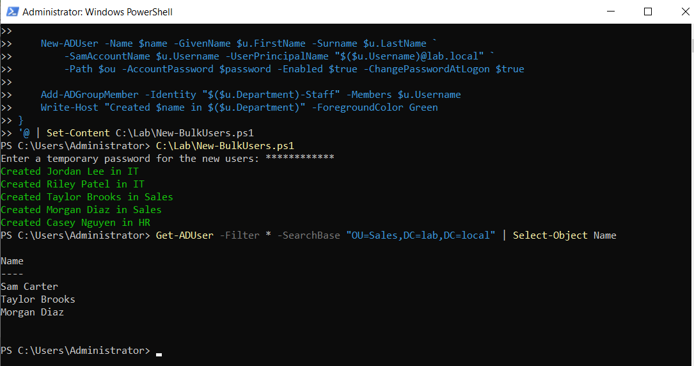
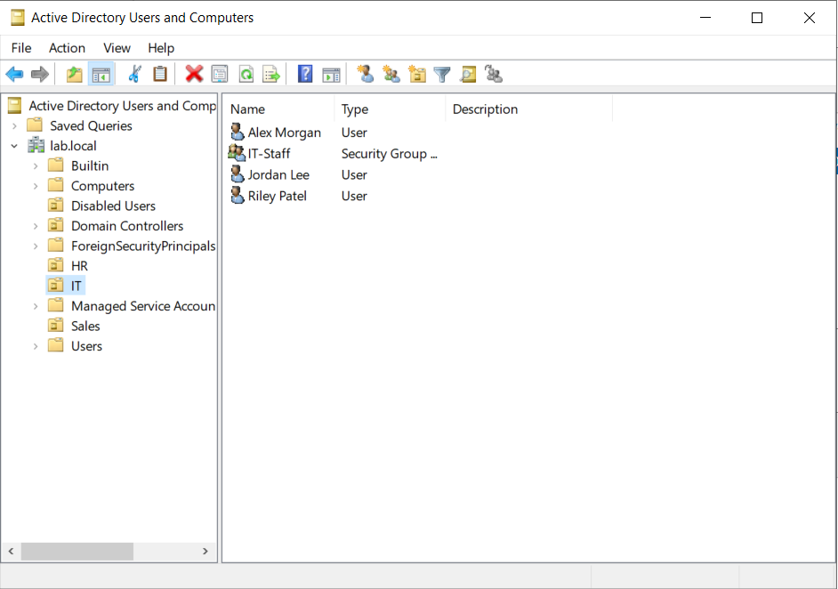
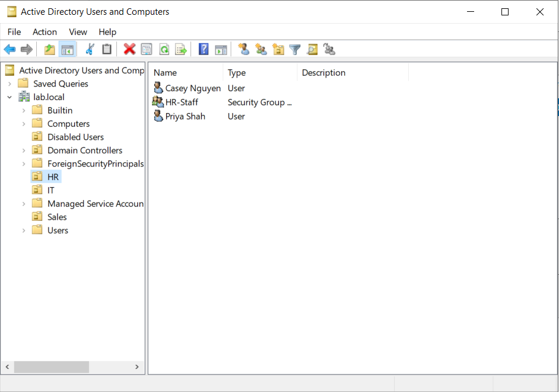

A few extra test users in the screenshots (like Alex Morgan, Priya Shah, Sam Carter) were created by hand in the console while I was testing. The CSV itself creates five users.

## Script 2: Offboarding

`scripts/Disable-LabUser.ps1 -Username <name>` does the following:

1. Looks up the user and stops if they do not exist
2. Disables the account
3. Removes the user from all groups
4. Moves the account to the `Disabled Users` OU
5. Writes a timestamped line to `deprovision-log.txt`

I disable and move accounts instead of deleting them, because in a real company you usually keep the account for a while in case of audits or mistakes.

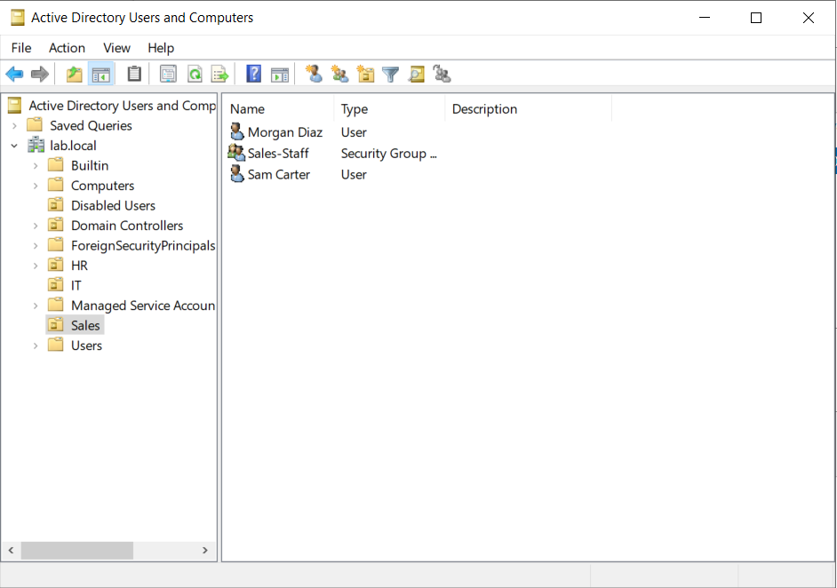
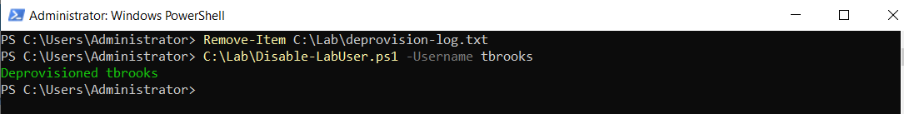
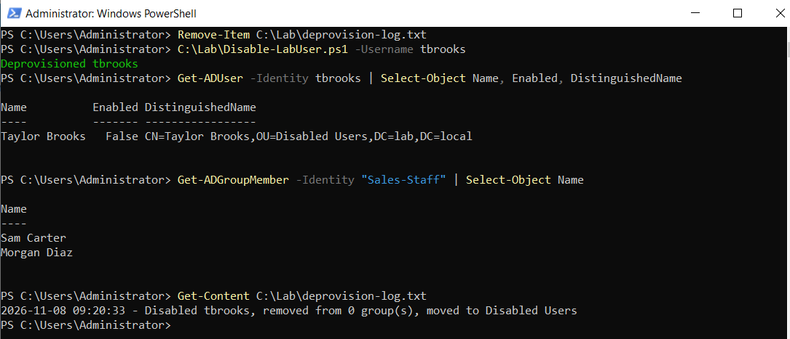
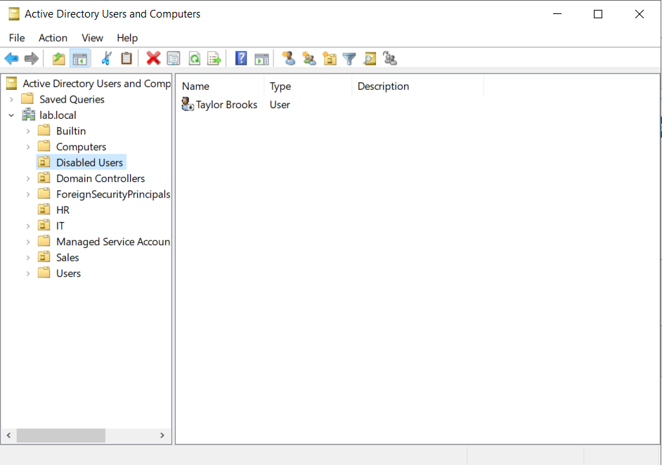

Second run on a different user, showing one group removed:

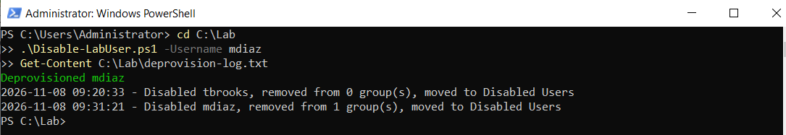

## Group Policy

Group Policy lets an admin control settings for many users and computers from the domain controller, instead of changing each machine by hand. I set up two policies.

**1. Password policy (whole domain).** Password rules only apply when they are set at the domain level, so I edited the Default Domain Policy and set the minimum password length to 12 characters (complexity requirements were already enabled).

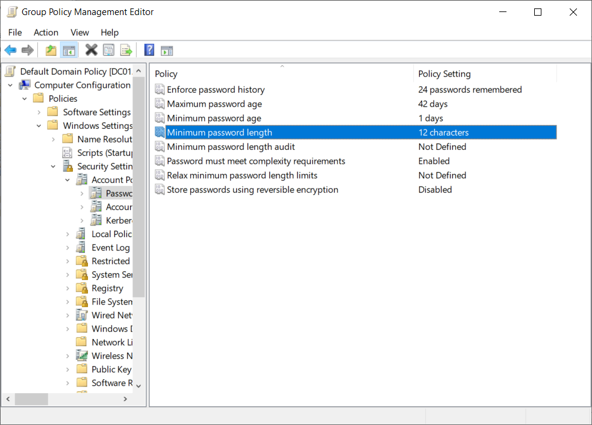

**2. Screen Lock (HR OU only).** I created a new GPO called `Screen Lock` under User Configuration → Administrative Templates → Control Panel → Personalization. It turns on the screen saver, sets the timeout to 600 seconds (10 minutes) and requires a password to unlock. I linked it to the HR OU because HR handles sensitive data.

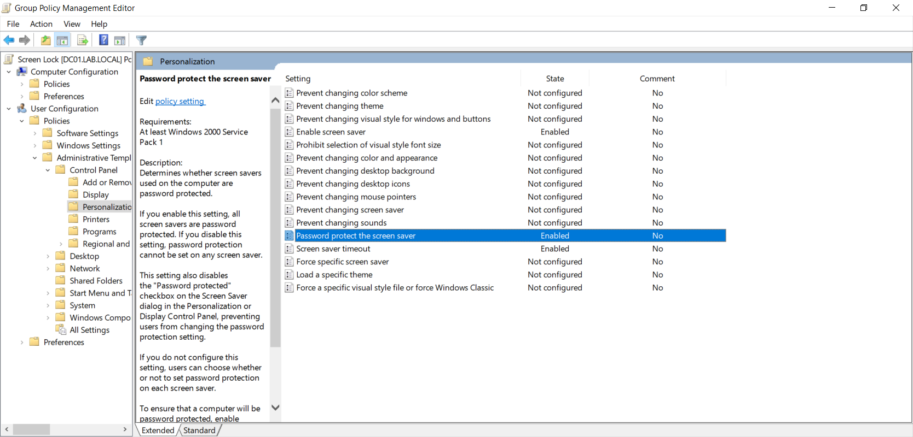
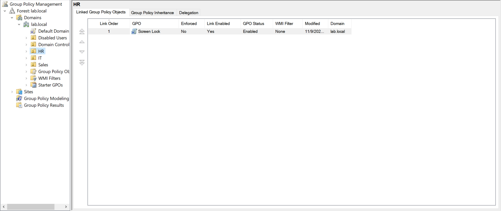

**Checking it worked.** I ran `gpupdate /force`, then `net accounts` (shows Minimum password length: 12) and `Get-GPInheritance` on the HR OU (shows Screen Lock, enabled, order 1).

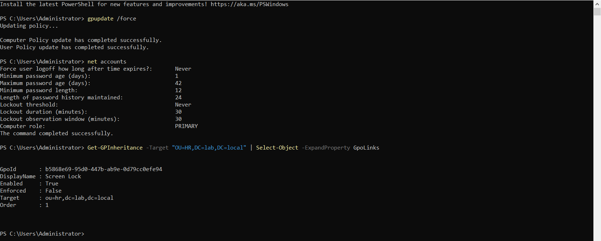

Limit: my lab only has the domain controller. The password policy is confirmed live with `net accounts`, but I have not yet seen Screen Lock apply on a separate domain-joined client. That is the next step.

## A bug I found and fixed

My first version of the offboarding script printed a green "Deprovisioned" message and wrote a success line to the log, even when part of it had failed.

The cause was a typo: I had named the OU "Disables Users" instead of "Disabled Users". The `Move-ADObject` step failed, but the script kept going and reported success anyway. The account had been disabled and removed from its group, but never moved, and the log was wrong.

The fix:

- Fixed the OU name
- Added `-ErrorAction Stop` to each AD command so any failure jumps to the `catch` block
- Wrapped the steps in `try/catch`, so a failure writes a `FAILED` line to the log and shows a red message, and the script exits with an error code

The takeaway for me: a script that reports success when it failed is worse than one that crashes, especially for something security related like removing access. That is also why the first log line for `tbrooks` says "removed from 0 group(s)". That user's group was already removed by the failed first run, so there was nothing left to remove on the rerun. The `mdiaz` run shows the normal case.

## Security notes

- No passwords are stored in any script or file
- New users must change their password at first logon
- Offboarding removes access first (disable, remove groups) and keeps an audit trail
- This is a lab on an isolated NAT network, not a production setup

## Skills I practiced

Active Directory (domains, OUs, groups), Group Policy, DNS, PowerShell scripting (`Import-Csv`, AD cmdlets, error handling, logging), identity lifecycle (joiner/leaver), VMware, Windows Server administration, troubleshooting.

## Planned next

- Joining a Windows 11 client to the domain and confirming the Screen Lock policy applies to an HR user
